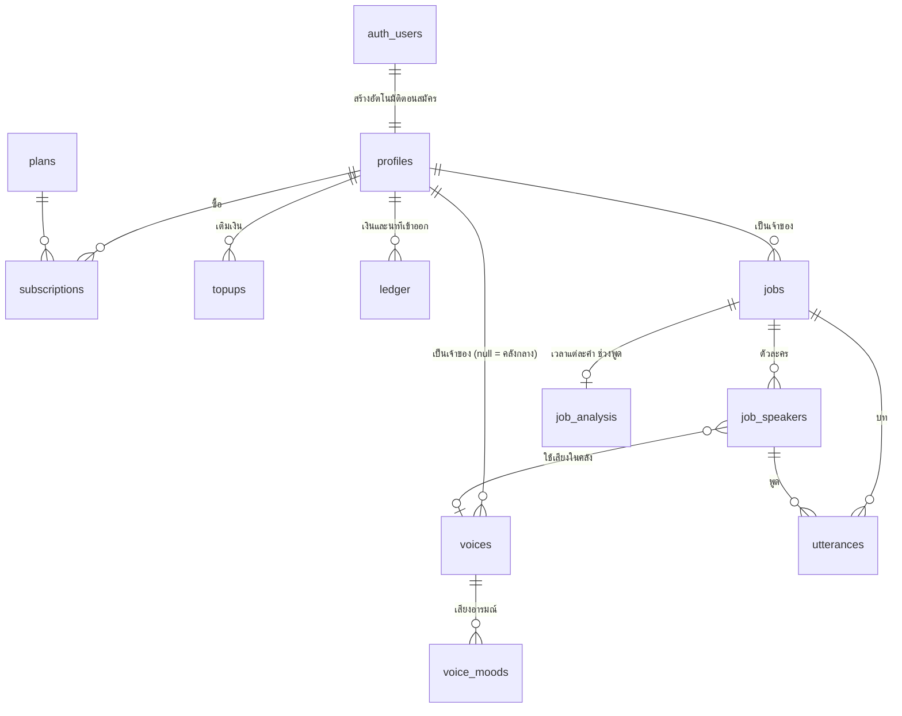

# ฐานข้อมูลบน Supabase

สคีมาทั้งหมดอยู่ใน `migrations/20261101000000_init.sql` ใช้แทนไฟล์ข้อมูล (JSON) ใน `data/` และ `accounts.db` เดิม

**Supabase เก็บแค่ข้อมูล** ไฟล์เสียง วิดีโอ และรูป ยังอยู่ใน `data/` บนเครื่องที่รัน API ตามโครงเดิม
(`data/jobs/<id>/...`, `data/voices/<id>/...`) หน้าเว็บโหลดไฟล์ผ่าน API เหมือนเดิม
ตารางเก็บเฉพาะชื่อไฟล์ที่เดาจาก id ไม่ได้ เช่น `jobs.input_name` (input.mp4 / input.mkv) และ `voices.image` (image.jpg / image.png)

## ตาราง



| ตาราง | แทนที่ของเดิม | หมายเหตุ |
|---|---|---|
| `profiles` | `users` ใน accounts.db | ผูกกับ `auth.users` ของ Supabase Auth (รหัสผ่าน โทเคน ยืนยันอีเมล ให้ Supabase จัดการ) ยอดเงินเป็นสตางค์ |
| `plans` | `PLANS` ในโค้ด | แก้ราคาและนาทีได้จากตาราง |
| `subscriptions`, `topups`, `ledger` | ตารางชื่อเดียวกันใน accounts.db | ledger ตัดนาทีได้ครั้งเดียวต่องาน และคืนได้ครั้งเดียว (unique index) |
| `app_settings` | `data/settings.json` | แถวเดียว เก็บ RuntimeSettings เป็น jsonb |
| `voices`, `voice_moods` | `data/voices/<id>/voice.json`, `embedding.npy` | ลายเสียงเป็น `vector(256)` (pgvector) |
| `jobs` | `job.json` | เพิ่มคอลัมน์คิว: `queued_at`, `worker_id`, `lease_until`, `cancel_requested` |
| `job_speakers` | `speakers`, `voice_map`, `speaker_names` ใน job.json และ `speaker_voices.json` | หนึ่งแถวต่อตัวละคร |
| `utterances` | `transcript.json` และ `lines` ใน `gpu_analysis.json` | หนึ่งแถวต่อประโยค พร้อมความสะอาด ระดับเสียง และลายเสียง |
| `job_analysis` | `words.json`, `turns.json`, `speech` ใน `gpu_analysis.json` | อ่านทั้งก้อนครั้งเดียว จึงเก็บเป็น jsonb |

id ของงานและเสียงยังเป็นตัวอักษรฐาน 16 ยาว 12 ตัวเหมือนเดิม ลิงก์ `/jobs/<id>` เดิมจึงใช้ต่อได้

## ฟังก์ชันในฐานข้อมูล

- `claim_next_job(worker, light, user_cap)` หยิบงานถัดไปให้ worker แบบวนตามผู้ใช้ จำกัดงานหนักต่อคน ใช้ `FOR UPDATE SKIP LOCKED` กันหยิบงานซ้ำ งานที่ lease หมด (worker ตาย) กลับเข้าคิวเอง
  (ไฟล์อยู่บนเครื่องนี้ worker ทุกตัวจึงต้องรันบนเครื่องเดียวกัน หรือเห็นโฟลเดอร์ `data/` เดียวกัน)
- `charge_job(user, job, seconds, per_minute)` ตัดนาทีแพ็กเกจก่อน แล้วหักเงิน ทำในธุรกรรมเดียว ตัดซ้ำไม่ได้
- `refund_job(job)` คืนเงินและนาทีตามที่ตัดไปจริง คืนซ้ำไม่ได้

## สิทธิ์

- API (FastAPI) ใช้ `service_role` key ข้าม RLS ได้ทั้งหมด
- หน้าเว็บที่อ่านตรงด้วย anon key + JWT ของผู้ใช้ เห็นเฉพาะงาน บท และประวัติเงินของตัวเอง ผู้ดูแล (`profiles.is_admin`) เห็นทั้งหมด
- ผู้ใช้แก้ได้เฉพาะ: ชื่อที่แสดง, แนวเรื่อง/ชื่อเฉพาะ/ซับของงาน, ตัวละครและบทของงานตัวเอง ยอดเงิน สถานะงาน และเจ้าของ แก้ผ่าน API เท่านั้น (ตัดสิทธิ์ระดับคอลัมน์)
- ตาราง `jobs` เปิด Realtime ให้หน้าเว็บรับความคืบหน้าแทนการถามซ้ำทุก 2 วินาที

## ใช้งาน

```bash
supabase link --project-ref <ref>
supabase db push          # หรือวางไฟล์ migration ใน Dashboard → SQL Editor แล้วกด Run
```

จากนั้นตั้งใน `.env` แล้วคัดลอกข้อมูลเดิมขึ้นไป (รันซ้ำได้ ไม่แตะไฟล์ใน `data/`):

```bash
DB_BACKEND=supabase
SUPABASE_URL=https://<ref>.supabase.co
SUPABASE_SERVICE_ROLE_KEY=...

python scripts/migrate_to_supabase.py           # ดูว่าจะคัดลอกอะไร
python scripts/migrate_to_supabase.py --apply
```

## ย้ายโค้ดแล้วถึงไหน

| ส่วน | สถานะ |
|---|---|
| ค่าตั้งระบบ (`app_settings`) | ใช้ Supabase แล้ว |
| คลังเสียง (`voices`, `voice_moods`, ลายเสียง) | ใช้ Supabase แล้ว |
| งานพากย์ ตัวละคร บท คิว | ยังเป็นไฟล์ JSON |
| บัญชี เงิน แพ็กเกจ | ยังเป็น `accounts.db` |

ส่วนที่ย้ายแล้วยังเขียน `voice.json` / `settings.json` ไว้ด้วยเป็นสำรอง ถ้าตอนเริ่ม API อ่าน Supabase ไม่ได้จะใช้ไฟล์แทน
และกลับไปใช้ไฟล์ล้วนได้ด้วย `DB_BACKEND=files`

ทดสอบแล้วกับ Postgres 16 + pgvector (จำลอง `auth` และ `supabase_realtime`): สร้างโปรไฟล์อัตโนมัติ, คิววนตามผู้ใช้และเพดานต่อคน,
lease หมดแล้วงานกลับเข้าคิว, ตัดและคืนนาทีซ้ำไม่ได้, เงินไม่พอได้ error, RLS และสิทธิ์รายคอลัมน์
